# Couchcade

Party games on the big screen, with your phone as the controller. Any computer connected to the TV (or any big screen with a browser) shows the game; phones on the same Wi-Fi join by scanning a QR code. Nobody installs anything on their phone, there are no accounts, and nothing goes over the internet.

<p align="center">
  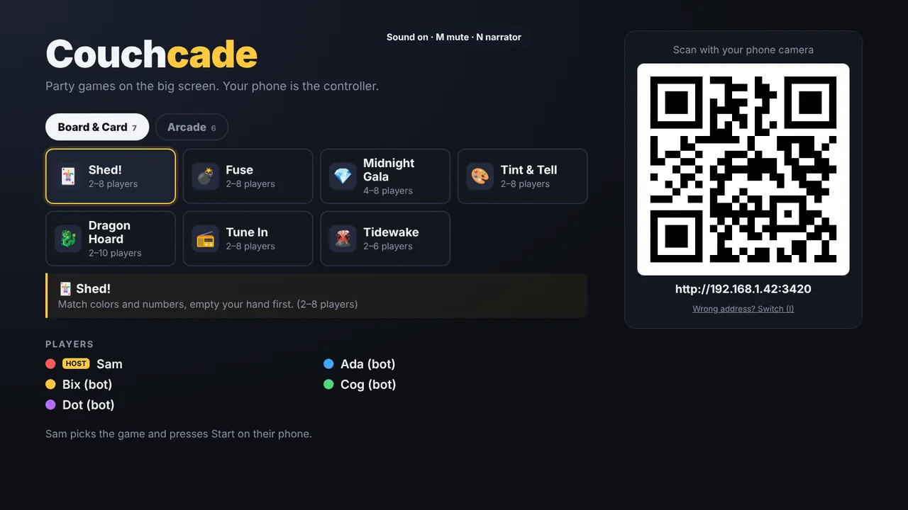
  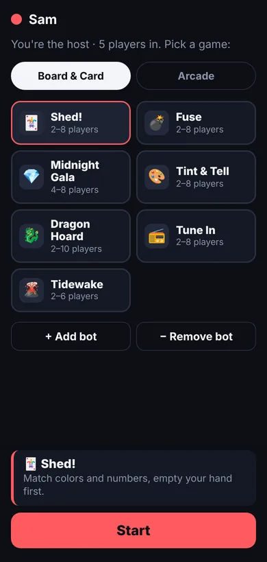
</p>

Thirteen games for 2 to 8 players (some work solo), from card and board games played on your phone's screen to joystick brawlers. Bots can fill any empty seats. It runs on macOS, Windows and Linux, from a download, `npx couchcade`, Docker or the source.

**Contents:** [Games](#games) · [Run it](#run-it) · [Playing](#playing) · [Troubleshooting](#troubleshooting) · [Contributing](CONTRIBUTING.md)

## Games

The game picker has two tabs. **Board & Card** games are turn-based: your hand, your secret role or your vote is on your phone, and the table is on the TV. **Arcade** games are real-time: your phone becomes a joystick and buttons.

### Board & Card

#### Shed! · 2–8 players
A color-matching card game. Your hand is on your phone: match the top card's color or number, use Skip, Reverse, Draw 2 and Wilds, stack +2s and +4s to pass the penalty along, and tap **Last card!** before someone catches you.

<p>
  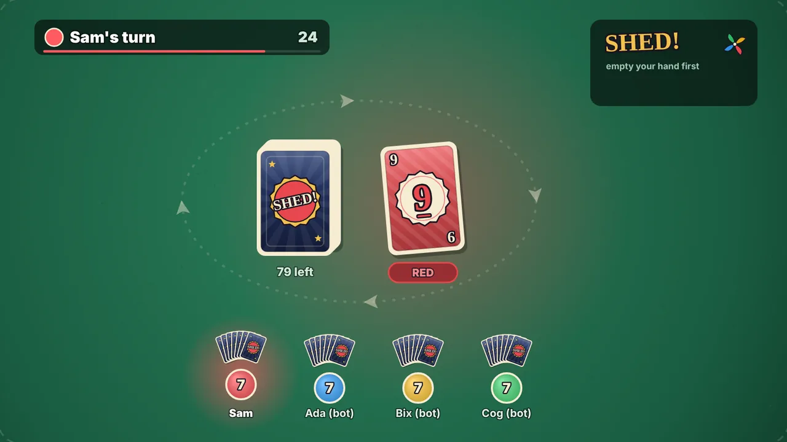
  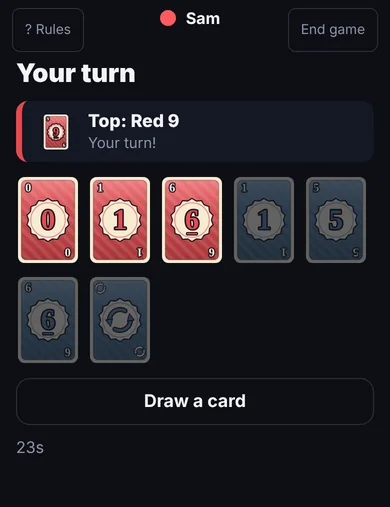
</p>

#### Fuse · 2–8 players
A push-your-luck card game in a fireworks workshop. Play cards, then draw from the crate; draw a Bomb and you're out, unless you douse it with a Bucket (and secretly hide it back in the crate) or cut the right one of three wires. Peek, nudge, skip and pass the trouble along with 12 kinds of card. The TV shows the odds of a Bomb and a burning fuse as the turn timer. Last one standing wins.

<p>
  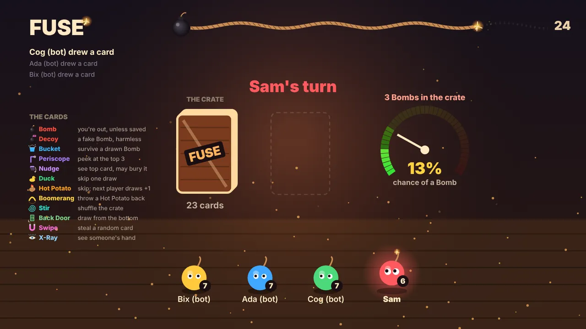
  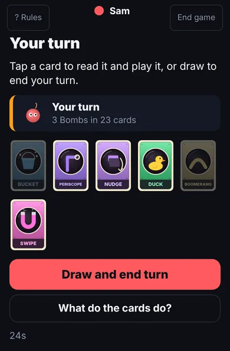
</p>

#### Midnight Gala · 4–8 players
Hidden roles in a mansion. Secret Thieves steal gems at night; everyone picks a room, compares alibis and evidence in the morning, and votes someone out. Roles: Thief, Detective, Bodyguard (5+), Gossip (6+) and Guest.

<p>
  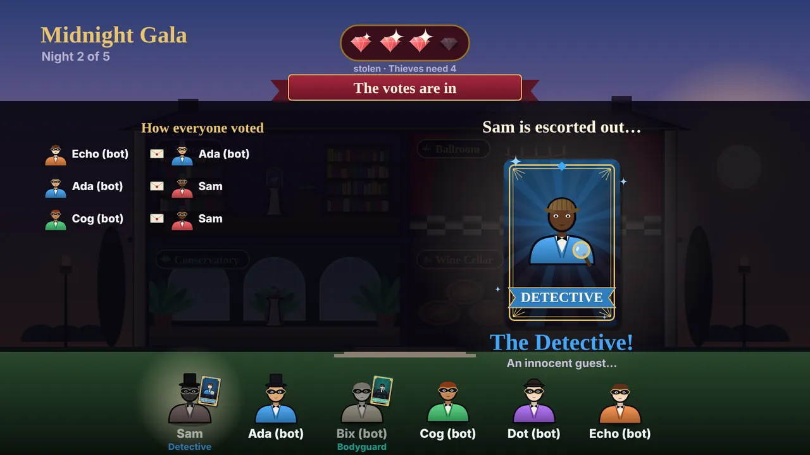
  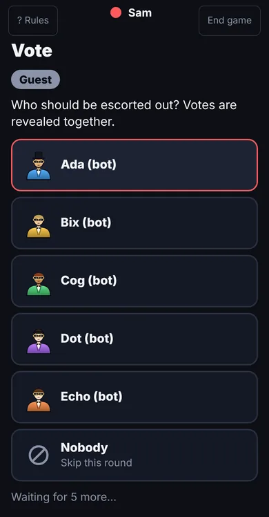
</p>

#### Tint & Tell · 2–8 players
A color-clue game around a big color wheel. The Teller picks a secret swatch and gives a one-word clue (no color names); everyone pins a guess on their phone's wheel. Then a two-word clue, and a chance to move. Closer pins score more, and the Teller scores the best guess.

<p>
  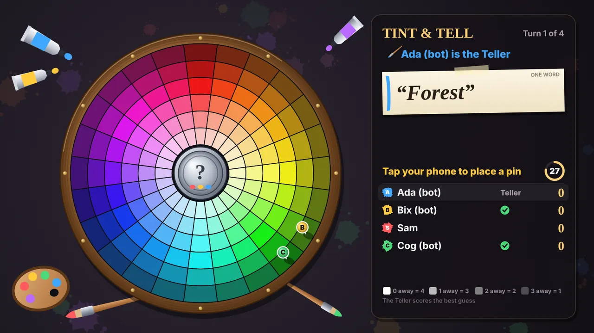
  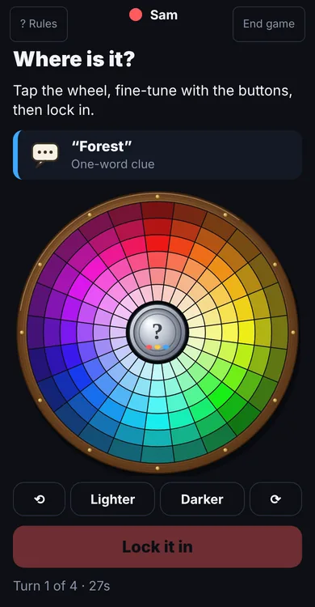
</p>

#### Dragon Hoard · 4–8 players in two teams, or 2–3 co-op
A team word-clue game. 25 words on the TV each hide an Ember gem, a Frost gem, dust or the sleeping dragon. Each team's Keeper sees the key on their phone and gives one word and a number ("ocean 3"); teammates talk it over and vote on their phones. Find all your gems first, and don't wake the dragon. 621 words.

<p>
  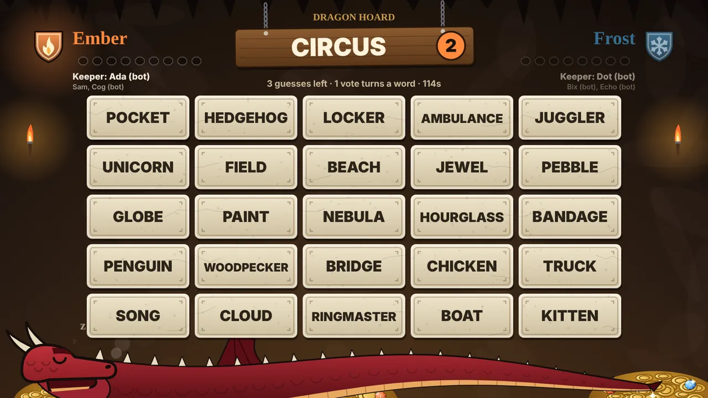
  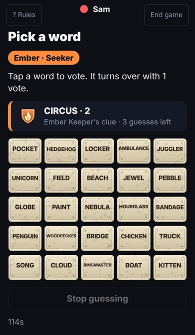
</p>

#### Tune In · 2–8 players, co-op
A radio-dial guessing game. Each card is a band between two opposites (Bland ↔ Spicy) with a secret station on it. The DJ gives a clue; everyone drags their own needle, and the red needle on the TV is the crowd's average, so talk it out. 436 original cards.

<p>
  
  
</p>

#### Tidewake · 2–6 players
An island trading board game. Settle a volcanic island that grows Driftwood, Coconut, Fish, Shell and Stone; roll, collect, trade with each other or the bank, and build Trails, Huts and Lighthouses from a map on your phone. Roll a 7 and the volcano erupts. The island is shuffled every game. First to 8 points.

<p>
  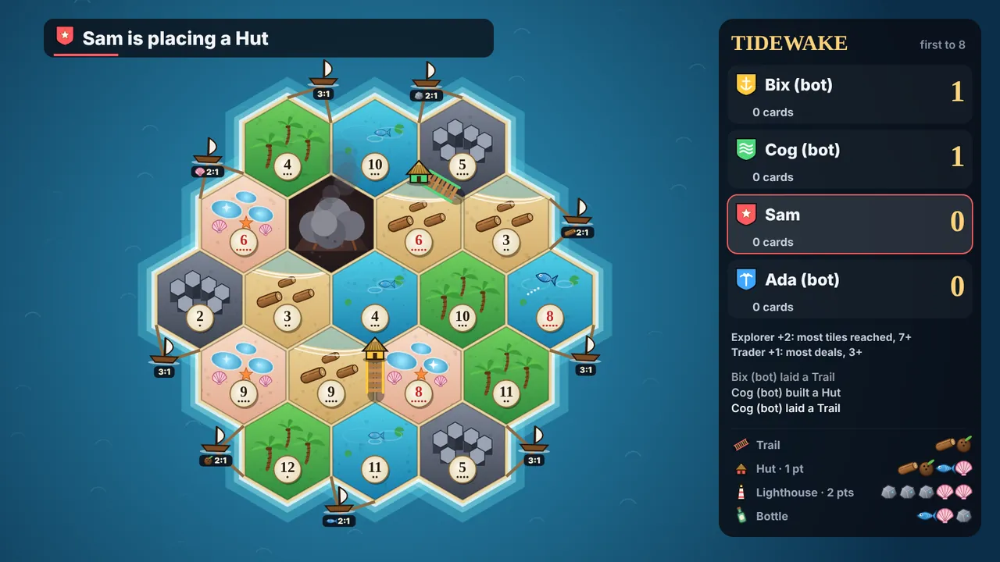
  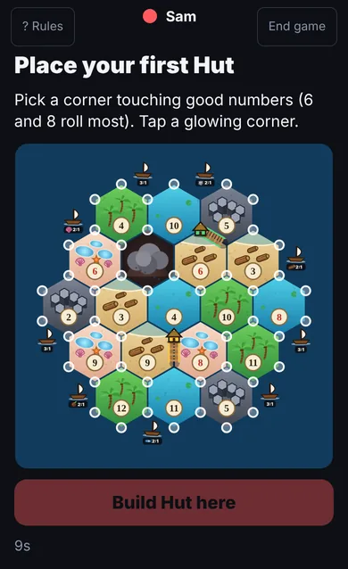
</p>

### Arcade

In every arcade game the phone is a controller: drag anywhere on the left half to move, and tap the buttons on the right. Turn the phone sideways.

<p align="center">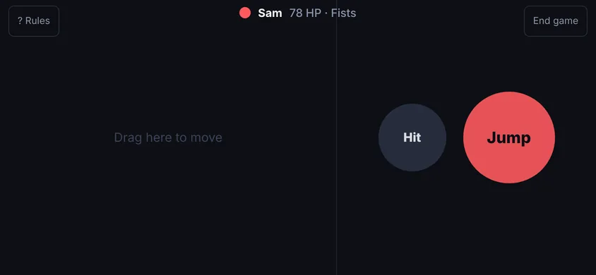</p>

<table>
  <tr>
    <td width="50%">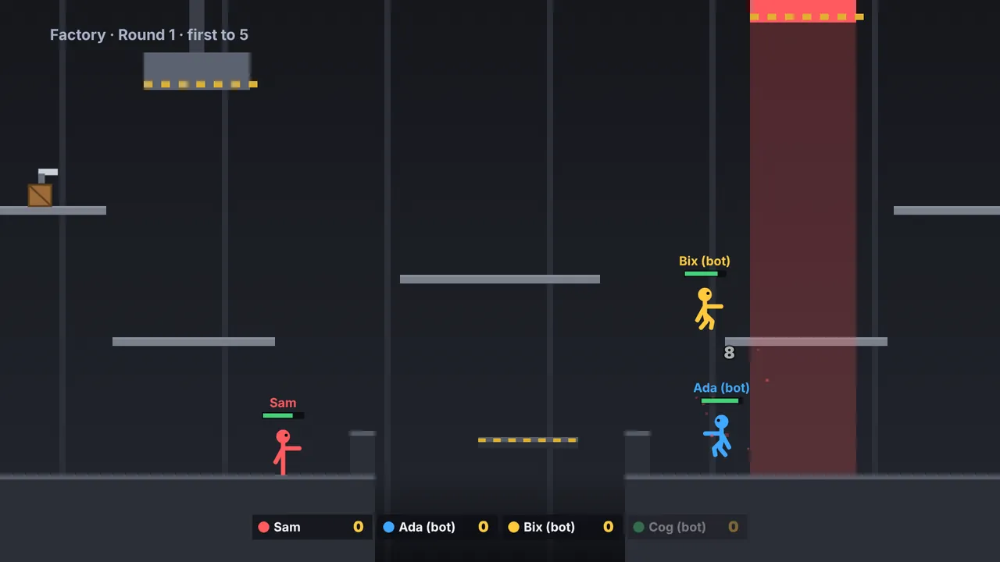<br><b>Stickup</b> · 2–8 players<br>A side-view stick-figure brawl. Grab weapons that parachute in (bat, pistol, shotgun, grenades, railgun) across Rooftops, a Factory and a Lava Pit. First to 5 rounds.</td>
    <td width="50%">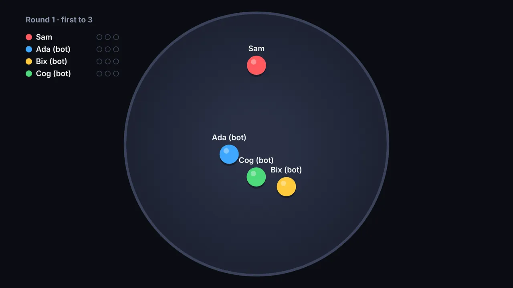<br><b>Bumper Arena</b> · 1–8 players<br>Dash into each other and shove everyone off a shrinking platform. Last one on wins the round; first to 3.</td>
  </tr>
  <tr>
    <td>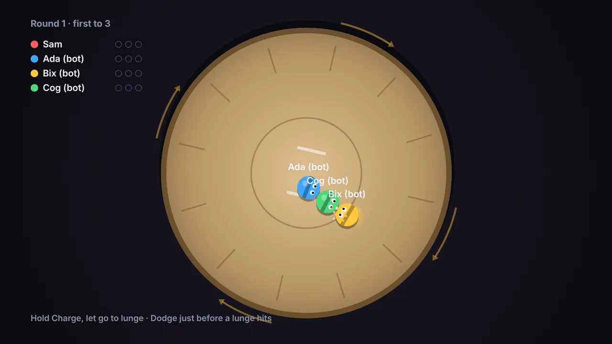<br><b>Sumo Spin</b> · 1–8 players<br>Push everyone off a spinning, tilting ring. Hold to charge a lunge, and dodge at the last moment to send the lunger stumbling.</td>
    <td>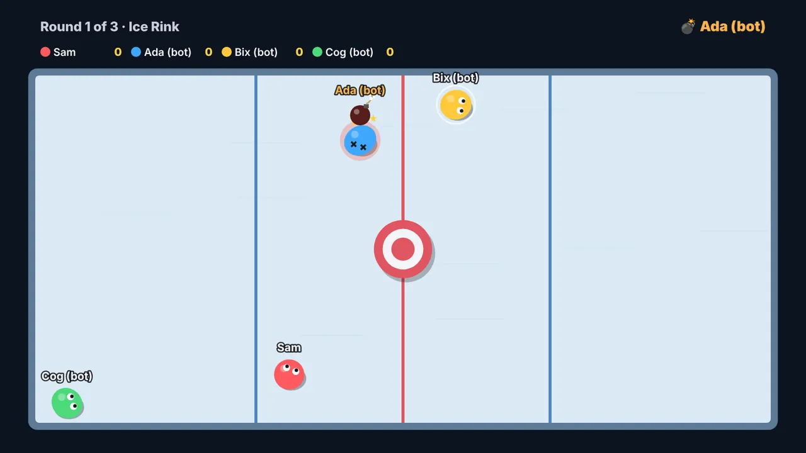<br><b>Hot Potato Pileup</b> · 2–8 players<br>Someone always holds a ticking bomb with a secret fuse. Tackle to pass it, hop to dodge, and don't be holding it when it blows.</td>
  </tr>
  <tr>
    <td>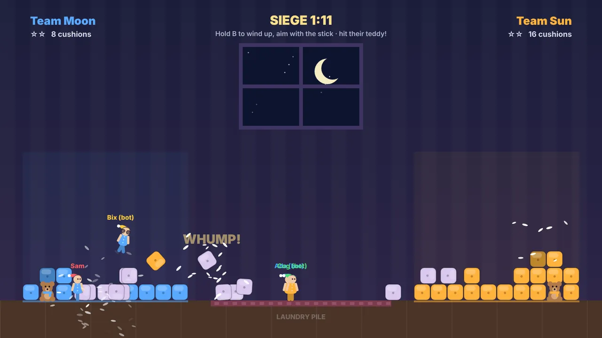<br><b>Pillow Fort Siege</b> · 2–8 players in two teams<br>Build a cushion fort around your teddy bear, then lob pillows to knock down the other team's walls and bonk their teddy.</td>
    <td valign="top"><b>Sandbox</b> · 1–8 players<br>Steer a dot around. Handy for checking that every phone connects and for measuring lag.</td>
  </tr>
</table>

## Run it

Pick whichever way of starting it suits you; all of them run a small server on that computer and show you where to point the TV and the phones.

### Download (easiest)

Get the file for your computer from the [Releases page](https://github.com/gautama-bharadwaj/couchcade/releases/latest):

| Computer | File | Then |
| --- | --- | --- |
| Mac with Apple silicon (M1 or newer) | `Couchcade-macos-arm64.zip` | Unzip and open **Couchcade.app**. |
| Windows | `Couchcade-windows-x64.exe` | Double-click it. A console window shows the addresses; close it to stop. |
| Linux (x64, or arm64 such as a 64-bit Raspberry Pi) | `couchcade-linux-x64` / `couchcade-linux-arm64` | `chmod +x couchcade-linux-*` and run it. |

The app opens the TV page in your default browser by itself. The downloads aren't signed yet, so the first launch needs one extra click; see [Unsigned downloads](#unsigned-downloads). On a Mac, a small Couchcade window shows the addresses while it runs: **Open TV Page** brings the TV page back and **Quit Couchcade** stops it. On an Intel Mac, use `npx` or run it from source.

### With Node.js: `npx couchcade`

Any computer with [Node.js](https://nodejs.org) 20 or newer can run:

```bash
npx couchcade          # add --open to open the TV page in your browser
```

### From source

```bash
git clone https://github.com/gautama-bharadwaj/couchcade.git
cd couchcade
npm install
npm run dev            # restarts automatically when you edit server files
```

`npm start` runs it without the auto-restart and takes the options below (`npm start -- --open`).

### Docker

```bash
docker build -t couchcade .
docker run --rm -p 3000:3000 -e HOST_IP=192.168.1.50 couchcade   # HOST_IP = this computer's LAN address
docker run --rm --network host couchcade                         # Linux only: finds the address itself
```

Phones can't reach a container's own address, so with `-p` the QR code needs `HOST_IP`. With `--network host` (Linux) the container uses the host's network and finds the right address itself.

To keep it running on a server, use `docker compose up -d` with the included `docker-compose.yml`; see [Home server](#home-server-ubuntu-or-any-linux).

### Home server (Ubuntu or any Linux)

Couchcade can run all the time on a home server, so nobody has to start it before game night. The server needs no screen: the TV (a smart TV's browser, a streaming stick with a browser, or a laptop plugged into the TV) opens the server's address, and phones scan the QR code as usual. The server has to be on the same network as the phones.

**With Docker** (easiest to update):

```bash
git clone https://github.com/gautama-bharadwaj/couchcade.git
cd couchcade
docker compose up -d --build       # starts now and after every reboot
docker compose logs                # shows the TV and phone addresses
```

To update: `git pull && docker compose up -d --build`. The compose file uses the host's network, so the QR code shows the server's own LAN address (192.168.x.x or similar) and phones connect straight to it. If the code shows the wrong address, set `HOST_IP` in `docker-compose.yml`.

**Without Docker** (systemd): use the Linux download, which includes everything it needs.

```bash
# x64; use couchcade-linux-arm64 on an ARM server or Raspberry Pi
sudo curl -L -o /usr/local/bin/couchcade https://github.com/gautama-bharadwaj/couchcade/releases/latest/download/couchcade-linux-x64
sudo chmod +x /usr/local/bin/couchcade
sudo curl -L -o /etc/systemd/system/couchcade.service https://raw.githubusercontent.com/gautama-bharadwaj/couchcade/main/deploy/couchcade.service
sudo systemctl daemon-reload
sudo systemctl enable --now couchcade
journalctl -u couchcade -n 20      # shows the TV and phone addresses
```

To update, download the binary again and `sudo systemctl restart couchcade`. If the server has Node.js 20 or newer, `sudo npm install -g couchcade` works too: point `ExecStart` in the service file at the path `command -v couchcade` prints. (Ubuntu's own `nodejs` package is too old on 24.04 and earlier; use [NodeSource](https://github.com/nodesource/distributions) or the download.)

**Then:**

- On the TV, open `http://<server address>:3000/tv` and press **F** for full screen; press any key or click once so the browser allows sound. Find the server's address with `hostname -I` (the first one is usually it). Giving the server a fixed address in your router's DHCP settings keeps this URL the same, so the TV can bookmark it.
- If the server runs a firewall: `sudo ufw allow 3000/tcp`.
- Both setups use port 3000 exactly, so the address never moves; change `PORT` / `--port` if something else uses it.

### Then

- **TV:** open `http://localhost:3000/tv` on the computer connected to the TV, then press **F** for full screen. The startup message shows the exact address: if port 3000 is already taken by another app, Couchcade uses the next free one (3001 to 3010).
- **Phones:** scan the QR code on the TV. If phones can't open it, the computer may have picked the wrong network address (common with VPNs, Docker or virtual machines): click **Wrong address? Switch** under the code or press **I** on the TV to cycle through this computer's other addresses. See also [Troubleshooting](#troubleshooting).
- The first time it runs, your firewall may ask whether to allow incoming connections. Allow them on **private** networks, or phones can't connect.

### Options

| Flag | Environment variable | What it does |
| --- | --- | --- |
| `--port 3100` | `PORT=3100` | Use exactly this port (and stop if it's busy). Without it: 3000, or the next free one up to 3010. |
| `--host-ip 192.168.1.50` | `HOST_IP=192.168.1.50` | The address to put in the QR code, if the one it finds is wrong. |
| `--open` / `--no-open` | `OPEN_BROWSER=1` / `0` | Open the TV page in the default browser once running. The downloads do this by default; `npm run dev` and `npx` don't. |
| | `LOG_LEVEL=debug` | More detail in the log; see [Logging](CONTRIBUTING.md#logging). |
| | `LOG_FILE=off` or a path | Don't write a log file, or write it there. |
| | `DISABLE_LOG_API=1` | Turn off `/api/logs` (handy on a network shared with strangers). |
| | `TICK_HZ=30` | Halve the server's work on a very slow machine. |

Flags work with the downloads, `npx couchcade` and `npm start --`; `couchcade --help` lists them. Environment variables work everywhere, including `npm run dev` (`PORT=3100 npm run dev`).

## Playing

1. Everyone scans the code on the TV and types a name. The first person to join is the **host**.
2. The host picks a game on their phone (Board & Card or Arcade tab) and taps **Start**. Tap **+ Add bot** to fill empty seats with computer players; bots play every game.
3. Games with something to learn open with a short animated how-to-play on the TV, under a minute, with every phone showing the same step. The host can step through it or tap **Skip rules**. Mid-game, **? Rules** on any phone shows the rules again.
4. When the game ends, everyone sees the results, then it goes back to the lobby. Anyone who drops off can scan again and gets their seat back.

Sound plays on the TV: synthesized effects and a narrator using the browser's built-in voice. Browsers only allow sound after you interact, so press any key or click on the TV page once. The narrator sounds best in Chrome, Edge or Safari on macOS and Windows.

### TV keyboard shortcuts

| Key | What it does |
| --- | --- |
| **F** | Full screen |
| **Arrow keys** / **Tab** | Pick a game / switch between Board & Card and Arcade (in the lobby) |
| **B** / **Shift+B** | Add / remove a bot |
| **Enter** | Start |
| **M** / **N** | Mute / narrator on or off (remembered per browser) |
| **S**, **Esc** or **Enter**; **←/→** | Skip the how-to-play; step through it |
| **R** | Replay the how-to-play mid-game |
| **J** | Show a join QR code during a game |
| **I** | Switch the join address (when the computer has more than one) |
| **L** | Latency overlay |
| **Esc** twice | End the game (once skips the results) |

## Troubleshooting

- **Phones can't open the page.**
  - They must be on the same network as the computer. **Guest, office, school and hotel Wi-Fi** usually has "client isolation", which stops devices on it from reaching each other; Couchcade can't work around that. Use a home network, or turn on your phone's hotspot and connect the computer and the other phones to it.
  - **Firewall.** Windows Defender Firewall asks the first time: allow Couchcade on **private** networks. If you clicked Cancel, go to Windows Security > Firewall & network protection > Allow an app through firewall, and tick **Private** for Couchcade (or Node.js). Windows also blocks it if your Wi-Fi is set to Public: Settings > Network & internet > Wi-Fi > your network > **Private network**. On macOS, check System Settings > Network > Firewall > Options and allow Couchcade (or `node`). On Linux with ufw: `sudo ufw allow 3000/tcp`.
  - A **VPN** on the computer can grab the network; try with it off.
- **Wrong address in the QR code.** Press **I** on the TV (or click **Wrong address? Switch**) to try this computer's other addresses. To fix it for good, start with `--host-ip 192.168.1.50` (or `HOST_IP=...`) using the address of the computer's Wi-Fi or Ethernet connection. Under WSL or in Docker the detected address is the virtual one: set `HOST_IP` to the Windows/host machine's address.
- **"Port 3000 is already in use".** Without `--port`, Couchcade moves to 3001-3010 by itself. With `--port`/`PORT` it uses exactly that port, so pick another or close the other copy of Couchcade.
- **Lag in an action game.** Switch the TV to its **Game mode** picture setting; most of the delay is usually the TV's own picture processing and the Wi-Fi. Press **L** on the TV to see each phone's round trip and Wi-Fi stalls.
- **Something went wrong during a game.** The log has the details. Its path is in the startup message: from source `logs/couchcade.log`; the downloads and `npx` use `~/Library/Logs/Couchcade/` on macOS, `%LOCALAPPDATA%\Couchcade\logs\` on Windows and `~/.local/state/couchcade/` on Linux; Docker logs to `docker logs`. The last 300 lines are also at `http://<address>:3000/api/logs` from any device on the Wi-Fi. When reporting a problem, include the `WARN` and `ERROR` lines from around that time.

### Unsigned downloads

The downloads aren't signed or notarized yet, so the OS warns about them the first time:

- **macOS:** "Apple could not verify Couchcade..." Click **Done**, then open System Settings > **Privacy & Security**, scroll to Security, and click **Open Anyway** next to the message about Couchcade. Confirm, and it opens normally from then on.
- **Windows:** SmartScreen says "Windows protected your PC". Click **More info**, then **Run anyway**.
- **Linux:** browsers drop the executable bit on downloads, so run `chmod +x couchcade-linux-*` first.

## Contributing

Want to add a game or fix something? [CONTRIBUTING.md](CONTRIBUTING.md) covers how the code fits together, running it locally, adding a game, tests and releases.

## License

MIT. See [LICENSE](LICENSE).
